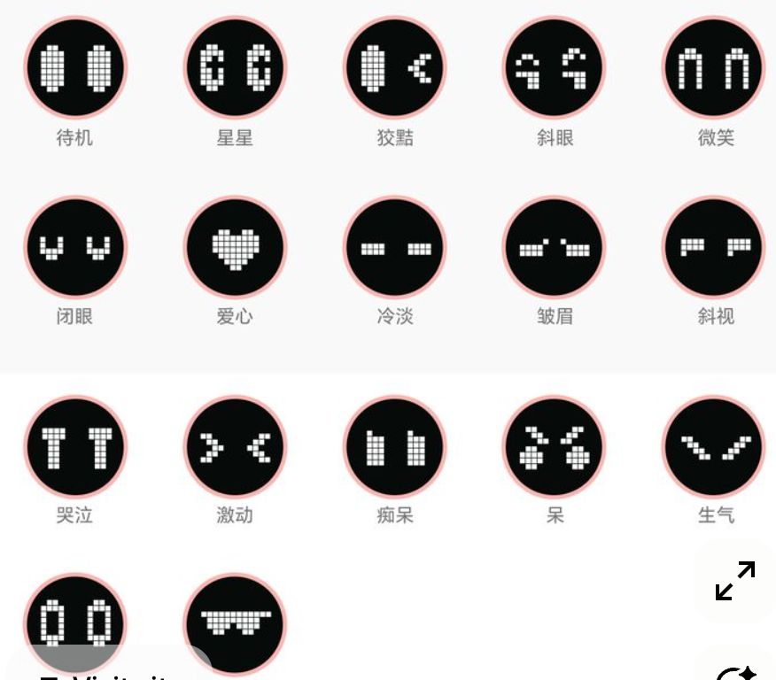

# Mochi Desktop Companion

A cross-platform desktop application featuring a lightweight, animated Micro-LED companion and personal productivity assistant. Built with Electron, TypeScript, React 19, and Vite.



---

## Overview

Mochi is an ambient desktop companion engineered for modern developer workflows. Floating directly on your desktop within a transparent, frameless canvas, Mochi combines retro-inspired hardware aesthetics with active desktop awareness to deliver a subtle, delightful, and non-intrusive focus companion.

---

## Visual Design & Hardware Aesthetics

- **Deep Velvet OLED Chassis**: The companion is framed in a dark titanium bezel with deep black internal backlighting, maximizing pixel contrast without washed-out gradients.
- **Precision Micro-LED Face**: Facial expressions are rendered via an authentic pixel matrix canvas inspired by Divoom hardware displays. Each pixel bead features rounded physical pitch, distinct emitter glow, and responsive scaling.
- **Razor-Thin Optical Lens Sheen**: Subtle top curvature glass reflection that mimics authentic physical glass without obstruction.
- **17 Distinct Pixel Expressions**: Includes standby capsule eyes, energetic chevron typing eyes, smiling arches, cyberpunk shades, centered pixel heart, curious side glances, and winks.
- **Organic Idle Micro-Behaviors**:
  - Natural blinking every 2.4 to 3.8 seconds with procedural double-blinking.
  - Curious wandering glances where eyes shift left or right to explore your screen before recentering.
  - Subtle friendly winks and breathing animations.

---

## System Activity & Typing Reactivity

Mochi actively monitors your desktop environment in real time without recording private keystrokes or data:

- **Active Typing Flow**: Real-time typing detection triggers an immediate reactive bounce and energetic expressions such as bold chevrons or curious glances.
- **Developer Environment Awareness**: Recognizes code editors (Antigravity IDE, VS Code, Cursor, Zed, Sublime Text, Xcode, Neovim) and responds with witty, flow-state thoughts.
- **Soundtrack Synchronization**: Detects active audio streams (Spotify, Apple Music) and transitions into a relaxed listening state.
- **Break & Sleep Detection**: Automatically enters rest mode after prolonged absence and warmly welcomes you back upon return.
- **Single-Line Dynamic Island Capsule**: Contextual remarks float directly above the mascot in an Apple Vision-inspired glass capsule, strictly preventing text from covering the mascot.

---

## Key Features

### 1. Floating Desktop Presence
- Borderless, transparent window supporting drag-and-drop relocation.
- Autonomous desktop wandering within safe monitor work areas (configurable).
- Interactive hover greetings and click interactions with synthesized audio chirps.

### 2. Compact Screen-Friendly Sizing
- Space-efficient default size (115px) designed not to crowd coding workspaces.
- Customizable dimensions ranging from 70px to 220px in Settings.
- Quick one-click size presets:
  - Mini (75px)
  - Small (95px)
  - Compact (115px)
  - Medium (140px)
  - Standard (170px)
- Fully responsive pixel matrix that preserves crispness and optical proportions across all scales.

### 3. Integrated Countdown & Pomodoro Timers
- Timestamp-based timer engine resilient against system sleep and window throttling.
- Pomodoro progression: Focus (25m), Short Break (5m), and Long Break (15m) with automatic transitions.
- Zero-overlap Dynamic Island integration: active countdowns display as an embedded chip inside the speech capsule, eliminating UI collisions.

### 4. Hydration & Mindful Break Reminders
- Periodic health prompts with configurable intervals (e.g., water every 45m, breaks every 60m).
- Native OS desktop notifications and duplicate-suppressed alerts.

### 5. Local Tasks & Scratchpad Notes
- Lightweight local task manager with priority flags (Low, Medium, High).
- Color-coded quick scratchpad for fast ideas and snippets.
- 100% offline local persistence with zero external cloud dependencies.

### 6. Natural Language Command Parser
- Offline deterministic parser supporting natural desktop queries:
  - "Start a 25-minute timer"
  - "Remind me to drink water in 30 minutes"
  - "Add task to review pull request"
  - "Start Pomodoro session"

---

## Architecture & Project Structure

```
mochi-desktop-companion/
├── docs/
│   └── images/                     # Documentation assets and screenshots
├── src/
│   ├── main/                       # Electron Main Process (Node.js)
│   │   ├── main.ts                 # Lifecycle orchestration and IPC routing
│   │   ├── windows/
│   │   │   ├── pet-window.ts       # Frameless floating companion window
│   │   │   └── assistant-window.ts # Glass companion dashboard window
│   │   ├── services/
│   │   │   ├── system-activity.ts  # Desktop activity & typing monitor
│   │   │   ├── timer-service.ts    # Target timestamp timer & Pomodoro engine
│   │   │   ├── reminder-service.ts # Water & break scheduler
│   │   │   ├── notification-service.ts # Native OS notification dispatcher
│   │   │   └── persistence-service.ts  # Atomic local storage engine
│   │   └── platform/
│   │       └── platform-adapter.ts # OS-specific integration hooks
│   ├── preload/
│   │   └── index.ts                # Secure typed contextBridge contract
│   ├── renderer/                   # React 19 Frontend
│   │   ├── index.html              # Shell markup
│   │   ├── App.tsx                 # Route coordinator (#pet vs #assistant)
│   │   ├── components/
│   │   │   ├── GlowLavaOrb.tsx     # Micro-LED canvas renderer & expression engine
│   │   │   ├── OrbPet.tsx          # Dynamic Island HUD & window coordinator
│   │   │   ├── AssistantPanel.tsx  # Master productivity panel
│   │   │   ├── TimerPanel.tsx      # Radial countdown & Pomodoro interface
│   │   │   ├── ReminderPanel.tsx   # Health interval configuration
│   │   │   ├── TaskPanel.tsx       # Priority task list
│   │   │   ├── NotesPanel.tsx      # Quick scratchpad notes
│   │   │   └── SettingsPanel.tsx   # Mascot size, opacity, and preferences
│   │   └── styles/
│   │       ├── glow-lava-orb.css   # OLED hardware glass styles & keyframes
│   │       └── index.css           # Glassmorphism design system
│   └── shared/
│       ├── types.ts                # TypeScript domain models and settings
│       ├── ipc-contracts.ts        # Type-safe IPC channels and payloads
│       ├── command-parser.ts       # Natural language command parsing
│       └── sound-effects.ts        # Procedural Web Audio synthesizer
├── tests/                          # Automated Vitest test suite
│   ├── command-parser.test.ts
│   ├── system-activity.test.ts
│   ├── timer-and-persistence.test.ts
│   └── reminder-and-behavior.test.ts
├── package.json
├── tsconfig.json
├── vite.config.ts
└── vite.main.config.ts
```

---

## Security & Privacy

- **Strict Context Isolation**: Renderer executes with `contextIsolation: true` and `nodeIntegration: false`.
- **Minimal Bridge Surface**: The preload layer exposes only strictly typed, validated IPC invocations.
- **Local-First & Private**: Activity awareness analyzes window metadata locally on-device. No keystroke logs, audio recordings, or telemetry are collected or transmitted.
- **Offline Capable**: All procedural audio, timers, task management, and animation engines function fully offline.

---

## Getting Started

### Prerequisites
- Node.js v18.0.0 or later (v20+ recommended)
- npm v9.0.0 or later

### Installation
```bash
npm install
```

### Development
Starts the Vite renderer server and Electron concurrently:
```bash
npm run dev
```

### Running Tests
Executes the automated test suite covering activity monitoring, timers, persistence, and command parsing:
```bash
npm test
```

### Building for Production
Compiles the React renderer bundle and Electron main process:
```bash
npm run build
```

---

## Packaging

Packages binaries using `electron-builder`:

```bash
# Package for the current operating system:
npm run package

# macOS (DMG & ZIP):
npm run package:mac

# Windows (NSIS Installer & Portable EXE):
npm run package:win

# Linux (AppImage & DEB):
npm run package:linux
```

All build artifacts are written to the `release/` directory.

---

## License

MIT License. See LICENSE for details.
