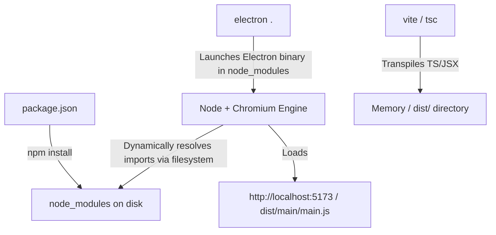
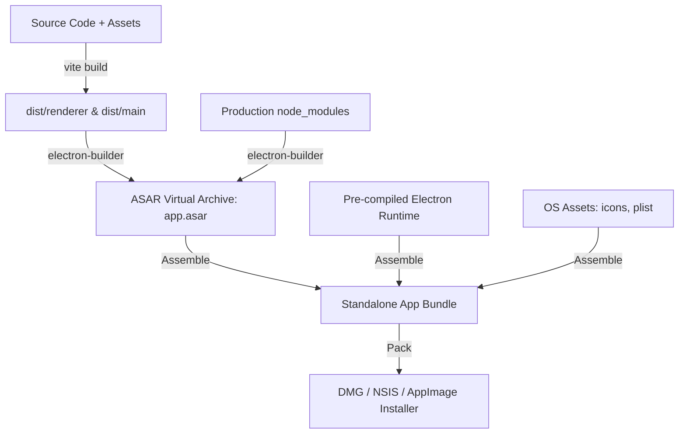

# Mochi Desktop Companion — Comprehensive Cross-Platform Architecture & Packaging Guide

> **Target Audience:** Engineering, Architecture, and DevOps  
> **Scope:** macOS (ARM64/x64/Universal), Windows (NSIS/Portable x64), Linux (AppImage/deb x64/arm64)  
> **Framework:** Electron 35 + React 19 + Vite 6 + TypeScript 5 + Three.js

---

## Table of Contents
1. [The Fundamental Mystery: How Development Differs from a Packaged App](#1-the-fundamental-mystery-how-development-differs-from-a-packaged-app)
   - [Development Mode Execution Flow](#development-mode-execution-flow)
   - [Packaged Production Execution Flow (Inside a `.app` / `.exe` / `.AppImage`)](#packaged-production-execution-flow-inside-a-app--exe--appimage)
   - [What an ASAR Archive Actually Is](#what-an-asar-archive-actually-is)
   - [What a DMG File Actually Is and How macOS Mounts It](#what-a-dmg-file-actually-is-and-how-macos-mounts-it)
2. [Why the DMG Worked on Your Mac but Failed on Another Mac](#2-why-the-dmg-worked-on-your-mac-but-failed-on-another-mac)
   - [Root Cause 1: Architecture Mismatch (Apple Silicon ARM64 vs Intel x86_64)](#root-cause-1-architecture-mismatch-apple-silicon-arm64-vs-intel-x86_64)
   - [Root Cause 2: Apple Gatekeeper, Quarantine Flags & Code Signing](#root-cause-2-apple-gatekeeper-quarantine-flags--code-signing)
   - [Root Cause 3: Hardened Runtime & Missing Notarization Ticket](#root-cause-3-hardened-runtime--missing-notarization-ticket)
   - [Root Cause 4: macOS Minimum OS Version Compatibility](#root-cause-4-macos-minimum-os-version-compatibility)
   - [Step-by-Step Fixes for Testing & Production Distribution](#step-by-step-fixes-for-testing--production-distribution)
3. [Deep Architectural Breakdown Across the 3 Operating Systems](#3-deep-architectural-breakdown-across-the-3-operating-systems)
   - [High-Level Process Architecture (Main, Preload, Renderer, GPU)](#high-level-process-architecture)
   - [Deep Dive: macOS (Darwin / Cocoa)](#deep-dive-macos-darwin--cocoa)
   - [Deep Dive: Windows (Win32 / DWM)](#deep-dive-windows-win32--dwm)
   - [Deep Dive: Linux (X11 vs Wayland Compositors)](#deep-dive-linux-x11-vs-wayland-compositors)
   - [OS Comparison Matrix (Transparency, Tray, Dock, Permissions, Autostart)](#os-comparison-matrix)
4. [Universal Packaging Specification for macOS, Windows, and Linux](#4-universal-packaging-specification-for-macos-windows-and-linux)
   - [Required Target Formats & Architectures](#required-target-formats--architectures)
   - [Production `electron-builder` Configuration](#production-electron-builder-configuration)
   - [Automated Multi-OS Build Matrix with GitHub Actions CI/CD](#automated-multi-os-build-matrix-with-github-actions-cicd)
5. [Extreme Memory & Resource Optimization Guide (< 100MB RAM Target)](#5-extreme-memory--resource-optimization-guide--100mb-ram-target)
   - [Why Electron Apps Consume High Memory (and How to Fix It)](#why-electron-apps-consume-high-memory)
   - [Chromium Flag Tuning for Ambient Desktop Widgets](#chromium-flag-tuning-for-ambient-desktop-widgets)
   - [Three.js & WebGL Memory Lifecycle Management](#threejs--webgl-memory-lifecycle-management)
   - [Multi-Window Virtualization & Lazy Destruction](#multi-window-virtualization--lazy-destruction)
   - [Memory Benchmark Script & Verification](#memory-benchmark-script--verification)

---

## 1. The Fundamental Mystery: How Development Differs from a Packaged App

### Development Mode Execution Flow
When running locally (`npm run dev`):

1. **Dynamic Resolution:** Node.js resolves imports dynamically using directory traversal up the tree until it finds `node_modules`.
2. **Local Compilation:** Vite runs an HTTP development server that compiles React/TypeScript on the fly via Hot Module Replacement (HMR).
3. **External Dependencies:** Packages are read from your physical hard drive in your user directory.

---

### Packaged Production Execution Flow (Inside a `.app` / `.exe` / `.AppImage`)
When you build the app for production (`npm run package` via `electron-builder`), **no dependencies are ever downloaded from the internet when a user runs the app.** Everything is completely frozen and bundled into a self-contained bundle.



#### What Actually Resides Inside the Built App
If you right-click `Mochi Desktop Companion.app` on macOS and select **"Show Package Contents"**, you will see:
```text
Mochi Desktop Companion.app/
├── Contents/
│   ├── Info.plist              # Bundle metadata (ID, version, permissions, category)
│   ├── MacOS/
│   │   └── Mochi Desktop Companion  # The compiled C++ Electron executable binary
│   ├── Frameworks/             # Precompiled Chromium, Node.js, and V8 dynamic libraries (.dylib)
│   │   ├── Electron Framework.framework
│   │   ├── Mantle.framework
│   │   └── Squirrel.framework (Auto-updater)
│   └── Resources/
│       ├── app.asar            # ALL your JavaScript, HTML, CSS, images, and package.json
│       └── icon.icns           # High-resolution multi-size macOS app icon
```

When the user launches the application:
1. The OS kernel executes `Contents/MacOS/Mochi Desktop Companion`.
2. The Electron binary starts Node.js and Chromium.
3. Node.js hooks into its virtual filesystem module (`asar.js`) and mounts `Contents/Resources/app.asar`.
4. It reads `package.json` inside `app.asar`, identifies `"main": "dist/main/main.js"`, and executes it.
5. All `require()` and `import` statements are intercepted by the ASAR reader and served instantly from memory without querying the internet or requiring Node to be installed on the user's computer.

---

### What an ASAR Archive Actually Is
- **ASAR** stands for *Atom Shell Archive Format*.
- It is a simple, uncompressed archive format (similar to `tar`) designed specifically for Electron.
- **Why it is used:**
  1. Prevents issues on Windows with long pathname limits (Win32 API limits paths to 260 characters; deep `node_modules` paths break without ASAR).
  2. Speeds up launch times dramatically: Instead of making thousands of individual filesystem I/O calls to read hundreds of small files, the operating system reads one continuous file stream.
  3. Prevents user tampering and keeps the source code structured.

---

### What a DMG File Actually Is and How macOS Mounts It
- **DMG** stands for **Apple Disk Image**.
- A `.dmg` is **not an executable program**. It is a compressed, read-only disk image file using the **UDIF** (Universal Disk Image Format) or **HFS+/APFS** virtual file system.
- When double-clicked:
  1. The macOS kernel mounts the DMG using `diskimages-helper` to a mount point at `/Volumes/Mochi Desktop Companion`.
  2. Finder opens a window displaying:
     - The application bundle: `Mochi Desktop Companion.app`
     - A symbolic link pointing to the user's system `/Applications` folder
     - A background instructional image guiding the user to drag the `.app` into `/Applications`.
  3. When the user drags `Mochi Desktop Companion.app` into `/Applications`, Finder copies the entire `.app` directory structure onto the local hard drive.
  4. The user ejects the DMG volume.

---

## 2. Why the DMG Worked on Your Mac but Failed on Another Mac

There are four specific reasons why an Electron DMG runs perfectly on your development Mac but crashes or gets blocked on another Mac:

### Root Cause 1: Architecture Mismatch (Apple Silicon ARM64 vs Intel x86_64)
- **The Problem:** Modern Macs use Apple Silicon chips (`arm64`: M1, M2, M3, M4). Older Macs use Intel processors (`x64`).
- When you run `electron-builder --mac` on an Apple Silicon Mac without specifying the architecture target, it builds an `arm64`-only binary by default.
- If you copy that `arm64` DMG to an **Intel Mac**, macOS cannot execute the ARM machine instructions. macOS shows an error:
  > *"You can’t open the application 'Mochi Desktop Companion' because this type of Mac does not support it."*
- Conversely, an `x64` binary on an Apple Silicon Mac will only work if the user has **Rosetta 2** installed.

#### The Solution: Build a Universal 2 Binary or Dual Architectures
A Universal 2 binary contains **both** `x64` and `arm64` compiled binaries merged together using Apple's `lipo` tool:
```json
"mac": {
  "target": [
    {
      "target": "dmg",
      "arch": ["universal"]
    },
    {
      "target": "zip",
      "arch": ["universal"]
    }
  ]
}
```

---

### Root Cause 2: Apple Gatekeeper, Quarantine Flags & Code Signing
- **Why it worked on your machine:** Because you compiled the files on your machine, your local kernel created the file inodes. There is **no quarantine attribute** attached.
- **Why it failed on the second machine:** When you transfer a `.dmg` via AirDrop, browser download, email, Slack, or Google Drive, macOS automatically attaches an extended filesystem attribute called:
  ```bash
  com.apple.quarantine
  ```
- When the user launches the app, **Apple Gatekeeper** inspects the quarantine flag and performs integrity checks:
  1. Does the app have a valid cryptographic code signature from an authorized Apple Developer?
  2. Is the Developer ID enrolled in the Apple Developer Program ($99/year)?
- If the app is unsigned or self-signed, Gatekeeper will block execution with:
  > *"Mochi Desktop Companion is damaged and can't be opened. You should move it to the Trash."*  
  *(Note: The app is not actually damaged; this is Apple's deceptive security warning for unsigned quarantined binaries).*

---

### Root Cause 3: Hardened Runtime & Missing Notarization Ticket
In your `package.json`, you have:
```json
"hardenedRuntime": true,
"gatekeeperAssess": false
```
- Since macOS 10.15 (Catalina), Apple requires **Notarization**.
- If `hardenedRuntime` is `true`, macOS requires the binary to be submitted to Apple's cloud notary service (`notarytool`) during CI/CD.
- Apple's servers scan the binary for malware, sign it with an Apple ticket, and "staple" the ticket to the DMG (`xcrun stapler staple`).
- If an app has hardened runtime enabled but is **not signed and notarized**, macOS refuses to launch it on other machines.

---

### Root Cause 4: macOS Minimum OS Version Compatibility
- Your `package.json` uses `"electron": "^35.0.0"`.
- **Electron 35** requires **macOS 11 (Big Sur) or newer**.
- If the second Mac is running macOS 10.15 (Catalina) or earlier, Electron 35 will fail to initialize.

---

### Step-by-Step Fixes for Testing & Production Distribution

#### Fix A: For Immediate Testing on Friend/Colleague Macs (Without Paying Apple $99/yr)
If you send the DMG to a friend or another Mac for testing right now:
1. Have them copy `Mochi Desktop Companion.app` to `/Applications`.
2. Open **Terminal** on their Mac and run:
   ```bash
   xattr -cr "/Applications/Mochi Desktop Companion.app"
   ```
   *(This strips the `com.apple.quarantine` extended attribute, allowing Gatekeeper to let it run immediately).*
3. Alternatively, they can **Right-Click (Control-Click)** the app in Finder -> Click **Open** -> Click **Open Anyway** in the security dialog.

#### Fix B: For Production Distribution (Seamless Double-Click for Anyone)
1. Enroll in the Apple Developer Program ($99/year).
2. Generate a **Developer ID Application** Certificate in Xcode or `developer.apple.com`.
3. Set your environment variables in CI/CD or your terminal:
   ```bash
   export CSC_LINK="path/to/certificate.p12"
   export CSC_KEY_PASSWORD="certificate-password"
   export APPLE_ID="your-apple-id@email.com"
   export APPLE_APP_SPECIFIC_PASSWORD="abcd-efgh-ijkl-mnop"
   export APPLE_TEAM_ID="YOURTEAMID"
   ```
4. Electron-builder will automatically sign the code and notarize it with Apple.

---

## 3. Deep Architectural Breakdown Across the 3 Operating Systems

### High-Level Process Architecture
Electron operates a multi-process architecture based on Chromium:

```text
┌─────────────────────────────────────────────────────────────┐
│                 MAIN PROCESS (Node.js runtime)              │
│  - Window Management (BrowserWindow)                        │
│  - System Tray (Tray, Menu)                                 │
│  - System Hardware APIs & Persistence (File I/O)            │
│  - IPC Message Router (ipcMain)                             │
└──────────────┬──────────────────────────────┬───────────────┘
               │                              │
        IPC Channels                   IPC Channels
               │                              │
┌──────────────▼──────────────┐┌──────────────▼───────────────┐
│     PRELOAD SCRIPT          ││       PRELOAD SCRIPT         │
│  - contextBridge.expose...  ││   - contextBridge.expose...  │
└──────────────┬──────────────┘└──────────────┬───────────────┘
               │                              │
┌──────────────▼──────────────┐┌──────────────▼───────────────┐
│   PET RENDERER (Chromium)   ││ ASSISTANT RENDERER (Chromium)│
│  - React 19 UI              ││  - Pomodoro Timer            │
│  - Three.js 3D Orb Scene    ││  - Task List & Notes UI      │
│  - Transparent Canvas       ││  - Settings Configuration    │
└─────────────────────────────┘└──────────────────────────────┘
```

---

### Deep Dive: macOS (Darwin / Cocoa)
- **Window Management Engine:** macOS uses Quartz / Core Graphics and the **Cocoa `NSWindow`** API.
- **Transparency & Alpha Blending:** macOS handles transparent windows (`transparent: true`) natively via `NSVisualEffectView` with hardware compositing. It has the cleanest transparency performance of all three platforms.
- **Floating Pet Layer:**
  - On macOS, setting `win.setAlwaysOnTop(true, 'floating')` elevates the window to Cocoa `NSFloatingWindowLevel`.
  - `win.setVisibleOnAllWorkspaces(true, { visibleOnFullScreen: true })` uses Cocoa `NSWindowCollectionBehaviorCanJoinAllSpaces` so the pet stays visible even when switching macOS Spaces or entering full-screen apps.
- **Tray & Menu Bar:**
  - Icons must use template sizing: `16x16` (`trayTemplate.png`) and `@2x` `32x32` (`trayTemplate@2x.png`).
  - Using the word `Template` in the filename tells macOS to automatically invert the icon color between Light and Dark mode.
- **Frameless Dragging:** macOS supports `-webkit-app-region: drag` smoothly via Core Animation.

---

### Deep Dive: Windows (Win32 / DWM)
- **Window Management Engine:** Windows uses the **Win32 API** and the **Desktop Window Manager (DWM)**.
- **Transparency & Alpha Blending:**
  - Windows requires DirectComposition / `WS_EX_LAYERED` styles.
  - In Electron, you must specify `backgroundColor: '#00000000'`.
  - *Gotcha:* On Windows, transparent frameless windows can suffer from click-through artifacts or black borders if hardware acceleration is disabled. Never disable hardware acceleration on Windows if transparency is required.
- **Always On Top:**
  - Windows uses `HWND_TOPMOST`. Unlike macOS, Windows does not have multiple named z-levels (`floating`, `screen-saver`). Calling `setAlwaysOnTop(true)` sets `SWP_NOMOVE | SWP_NOSIZE | HWND_TOPMOST`.
- **System Tray (Notification Area):**
  - Requires a `.ico` format containing `16x16`, `24x24`, and `32x32` mipmaps.
  - Windows does not support `Template` icon auto-inversion; you should provide a clear, high-contrast icon.
- **Taskbar vs Companion:**
  - Setting `skipTaskbar: true` applies the `WS_EX_TOOLWINDOW` extended window style so the pet does not clutter the taskbar.

---

### Deep Dive: Linux (X11 vs Wayland Compositors)
Linux has the most fragmented display ecosystem:
1. **X11 (Traditional):** Transparent windows work via the Composite extension (Picom, Compton, or KWin/Mutter). If a user has no compositor running (e.g. lightweight window managers like i3 or openbox without Picom), transparent windows will render with an opaque black box.
2. **Wayland (Modern default in Ubuntu 22+, Fedora 36+):**
   - Wayland has strict security sandboxing. Client applications cannot freely position themselves on screen or dictate global coordinates.
   - Electron 35 supports Wayland natively via Chromium's Ozone abstraction layer:
     ```bash
     --ozone-platform-hint=auto
     ```
   - *Gotcha with `alwaysOnTop`:* Wayland protocols do not standardly grant regular desktop apps permission to force themselves on top of other surfaces without compositor protocol extensions (`wlr-layer-shell`).
- **Packaging:**
  - **AppImage:** The gold standard for Linux. A single executable file containing the app and all system libraries. Runs on any Linux distribution without root privileges.
  - **Debian (`.deb`):** Standard for Ubuntu, Debian, Linux Mint.

---

### OS Comparison Matrix

| Feature | macOS (Darwin) | Windows (Win32) | Linux (X11/Wayland) |
| :--- | :--- | :--- | :--- |
| **Window Compositor** | Quartz / Core Graphics | DWM (DirectComposition) | X11 Compositor / Wayland |
| **Window Transparency** | Native, flawless (`#00000000`) | Native via DWM (`#00000000`) | Requires Compositor (Picom/Mutter) |
| **Global Z-Order** | Multi-level (`floating`, `status`) | `HWND_TOPMOST` | X11: Good; Wayland: Compositor dependent |
| **All Workspaces/Desktops** | `setVisibleOnAllWorkspaces(true)` | Supported (`SetWindowLongPtr`) | X11: Supported (`_NET_WM_DESKTOP`); Wayland: Limited |
| **Icon Format** | `.icns` (512x512@2x) | `.ico` (multi-res 16-256) | `.png` (512x512) |
| **Tray Icon Strategy** | `trayTemplate@2x.png` (auto-invert) | `trayIcon.png` (Color/Hi-contrast) | `trayIcon.png` (DBus AppIndicator) |
| **Primary Target Package** | `.dmg` + `.zip` (Universal) | `.exe` (NSIS) + Portable `.exe` | `.AppImage` + `.deb` |

---

## 4. Universal Packaging Specification for macOS, Windows, and Linux

### Required Target Formats & Architectures

| OS | Architectures | Target Formats | Output File Example |
| :--- | :--- | :--- | :--- |
| **macOS** | `universal` (arm64 + x64) | `dmg`, `zip` | `Mochi Desktop Companion-1.0.0-universal.dmg` |
| **Windows** | `x64` | `nsis` (Installer), `portable` | `Mochi Desktop Companion-Setup-1.0.0.exe` |
| **Linux** | `x64` | `AppImage`, `deb` | `Mochi Desktop Companion-1.0.0.AppImage` |

---

### Production `electron-builder` Configuration
Update your `package.json` `"build"` section to make your builds universal, cross-platform, and fully configured:

```json
{
  "build": {
    "appId": "com.mochi.desktopcompanion",
    "productName": "Mochi Desktop Companion",
    "directories": {
      "output": "release",
      "buildResources": "build"
    },
    "files": [
      "dist/**/*",
      "package.json"
    ],
    "mac": {
      "target": [
        {
          "target": "dmg",
          "arch": ["universal", "arm64", "x64"]
        },
        {
          "target": "zip",
          "arch": ["universal"]
        }
      ],
      "category": "public.app-category.productivity",
      "darkModeSupport": true,
      "hardenedRuntime": true,
      "gatekeeperAssess": false,
      "icon": "build/icon.icns",
      "entitlements": "build/entitlements.mac.plist",
      "entitlementsInherit": "build/entitlements.mac.plist",
      "minimumSystemVersion": "11.0.0"
    },
    "dmg": {
      "title": "${productName} ${version}",
      "icon": "build/icon.icns",
      "contents": [
        {
          "x": 130,
          "y": 220
        },
        {
          "x": 410,
          "y": 220,
          "type": "link",
          "path": "/Applications"
        }
      ],
      "window": {
        "width": 540,
        "height": 380
      }
    },
    "win": {
      "target": [
        {
          "target": "nsis",
          "arch": ["x64"]
        },
        {
          "target": "portable",
          "arch": ["x64"]
        }
      ],
      "icon": "build/icon.ico"
    },
    "nsis": {
      "oneClick": false,
      "allowToChangeInstallationDirectory": true,
      "createDesktopShortcut": true,
      "createStartMenuShortcut": true,
      "shortcutName": "Mochi Desktop Companion"
    },
    "linux": {
      "target": [
        {
          "target": "AppImage",
          "arch": ["x64"]
        },
        {
          "target": "deb",
          "arch": ["x64"]
        }
      ],
      "icon": "build/icon.png",
      "category": "Utility",
      "synopsis": "Ambient desktop companion and personal productivity assistant",
      "desktop": {
        "StartupWMClass": "Mochi Desktop Companion"
      }
    }
  }
}
```

---

### Automated Multi-OS Build Matrix with GitHub Actions CI/CD
You cannot build macOS binaries on a Windows or Linux machine (macOS builds require Apple's proprietary Darwin toolchain and SDK).  
The professional industry standard is to use a **GitHub Actions Build Matrix** that runs native virtual machines for each OS simultaneously.

Here is the complete workflow file to add to `.github/workflows/build-all-platforms.yml`:

```yaml
name: Multi-Platform Build & Release

on:
  push:
    tags:
      - 'v*'
  workflow_dispatch:

jobs:
  build:
    name: Build (${{ matrix.os }} - ${{ matrix.arch }})
    runs-on: ${{ matrix.os }}
    strategy:
      fail-fast: false
      matrix:
        include:
          - os: macos-latest
            arch: universal
            target: mac
            command: npm run package:mac
          - os: windows-latest
            arch: x64
            target: win
            command: npm run package:win
          - os: ubuntu-latest
            arch: x64
            target: linux
            command: npm run package:linux

    steps:
      - name: Checkout Code
        uses: actions/checkout@v4

      - name: Setup Node.js 20.x
        uses: actions/setup-node@v4
        with:
          node-version: 20.x
          cache: 'npm'

      - name: Install System Dependencies (Linux only)
        if: runner.os == 'Linux'
        run: |
          sudo apt-get update
          sudo apt-get install -y libarchive-tools libfuse2

      - name: Install Node Dependencies
        run: npm ci

      - name: Run Tests
        run: npm test

      - name: Compile Application (Vite Main + Renderer)
        run: npm run build

      - name: Package Executables
        run: ${{ matrix.command }}
        env:
          GITHUB_TOKEN: ${{ secrets.GITHUB_TOKEN }}

      - name: Upload Artifacts
        uses: actions/upload-artifact@v4
        with:
          name: mochi-companion-${{ matrix.target }}-${{ matrix.arch }}
          path: release/*.*
```

---

## 5. Extreme Memory & Resource Optimization Guide (< 100MB RAM Target)

### Why Electron Apps Consume High Memory
An Electron application runs:
1. **1 Node.js Main Process** (~30MB base)
2. **1 Chromium GPU Process** (~30MB base for hardware rendering)
3. **1 Chromium Renderer Process per BrowserWindow** (~40-80MB each)

If you have 3 open windows (`petWindow`, `assistantWindow`, `alertWindow`), naive implementations will consume:
`30MB + 30MB + 3 x 60MB = 240MB+ RAM`.

---

### Chromium Flag Tuning for Ambient Desktop Widgets
Add these low-overhead flags in `src/main/main.ts` before `app.whenReady()`:

```typescript
// Enforce aggressive memory limits for lightweight companion
app.commandLine.appendSwitch('js-flags', '--max-old-space-size=128'); // Limit V8 heap to 128MB
app.commandLine.appendSwitch('disable-renderer-backgrounding');       // Prevent tab stalling
app.commandLine.appendSwitch('disable-breakpad');                     // Disable crash reporter memory
app.commandLine.appendSwitch('disable-component-update');             // No runtime updater overhead
app.commandLine.appendSwitch('disable-domain-reliability');
app.commandLine.appendSwitch('enable-features', 'VaapiVideoDecoder');

// Optimize Linux Wayland rendering
if (process.platform === 'linux') {
  app.commandLine.appendSwitch('ozone-platform-hint', 'auto');
}
```

---

### Three.js & WebGL Memory Lifecycle Management
In `src/renderer/components/pet/PetOrb3D.tsx`:
1. **Reduce Pixel Ratio:** Do not render at raw Retina 3x scale. Clamp to `Math.min(window.devicePixelRatio, 1.5)`.
2. **Dispose Geometries and Materials:** WebGL GPU buffers are not collected by JavaScript Garbage Collection. You must explicitly dispose them:
   ```typescript
   useEffect(() => {
     return () => {
       geometry.dispose();
       material.dispose();
       renderer.dispose();
       renderer.forceContextLoss();
     };
   }, []);
   ```
3. **Idle FPS Throttling:** When the pet is idle and the user has not moved the mouse for 60 seconds, reduce Three.js render loop from 60 FPS to 15 FPS:
   ```typescript
   let lastFrameTime = performance.now();
   const targetFps = isUserIdle ? 15 : 60;
   const frameInterval = 1000 / targetFps;

   function animate(now: number) {
     requestAnimationFrame(animate);
     if (now - lastFrameTime < frameInterval) return;
     lastFrameTime = now;
     renderer.render(scene, camera);
   }
   ```

---

### Multi-Window Virtualization & Lazy Destruction
- **Never keep `assistantWindow` and `alertWindow` loaded in memory if they are closed.**
- Instead of keeping 3 BrowserWindows open all the time:
  1. Keep only `petWindow` active (consumes ~65MB total).
  2. Create `assistantWindow` only when the user clicks the pet or tray icon.
  3. When the user closes the assistant window, call `win.destroy()` or load `about:blank` to flush the Chromium renderer process from physical RAM.

---

### Memory Benchmark Script & Verification
You already have `scripts/benchmark-ram.js`. You can verify your live memory anytime by running:
```bash
npm run bench
```
Target Budgets:
- **Idle Pet Running:** `< 95 MB RSS`
- **Assistant Active:** `< 145 MB RSS`
- **CPU Utilization during Idle:** `< 0.8%`

---

## Summary Action Plan to Execute Universal Support
1. **For macOS:** Build with `--mac --universal` so both Intel and Apple Silicon Macs run natively without errors.
2. **For Testing on Other Macs:** Instruct testers to run `xattr -cr /Applications/Mochi\ Desktop\ Companion.app` or Control-Click Open.
3. **For Windows:** Run `npm run package:win` (or via GitHub Actions) to generate the NSIS Installer and Portable `.exe`.
4. **For Linux:** Run `npm run package:linux` (or via GitHub Actions) to generate `.AppImage` and `.deb`.
5. **Memory Constraint:** Keep lazy window allocation and clamp Three.js pixel ratio to maintain < 100MB RAM.
